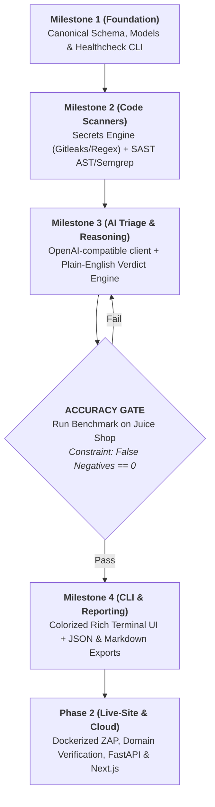

# CRY Platform — Developer Setup & Architecture Guide

Welcome to **CRY** (Open-source security testing platform for indie developers and small teams). This guide walks you step-by-step through setting up your development environment, configuring your API keys, understanding the architecture, and building the platform properly.

---

## 1. Honest Scope & Phase Breakdown

> [!IMPORTANT]
> **Scope for v0.1:** CRY v0.1 is a complete **Code, Secrets, Dependency (SCA), Configuration & Git Hygiene, and Network / IP Security platform**.  
> **Live-URL Dynamic Scanning (Full browser crawling DAST with ZAP/Nuclei)** is scheduled for **Phase 2**, after containerized Docker execution is configured and domain-ownership verification is built. We do not claim dynamic active spider crawling until that containerized sandboxing is live.

---

## 2. System Requirements & Prerequisites

| Tool | Minimum Version | Status on Your Machine | Purpose |
| :--- | :--- | :--- | :--- |
| **Python** | 3.11+ | ✅ Installed (3.13) | Core engine, scanner adapters & LLM triage |
| **Git** | 2.40+ | ✅ Installed (2.47) | Version control & repo cloning for scans |
| **Node.js** | 20+ | ✅ Installed (v22) | Future Next.js web dashboard |
| **LLM Provider** | OpenAI-compatible | ⏳ Pending setup | Fast cloud inference (Groq) or 100% private offline (Ollama) |
| **Docker Desktop** | Latest (WSL 2) | ⏳ Deferred to Phase 2 | Containerized DAST / ZAP scanning & live test targets |

---

## 3. Step-by-Step Setup Instructions

### Step 3.1: Activate Virtual Environment
Open your terminal inside `d:\CRY` and activate the pre-created `.venv`:

* **Windows PowerShell:**
  ```powershell
  .\.venv\Scripts\Activate.ps1
  ```
  *(If you get a script execution policy restriction error, run once: `Set-ExecutionPolicy -ExecutionPolicy RemoteSigned -Scope CurrentUser`)*

* **Windows Command Prompt (CMD):**
  ```cmd
  .\.venv\Scripts\activate.bat
  ```

* **macOS / Linux:**
  ```bash
  source .venv/bin/activate
  ```

---

### Step 3.2: Install Dependencies
With `.venv` active, install the project in editable mode with development dependencies:

```powershell
pip install --upgrade pip
pip install -e ".[dev]"
```

---

### Step 3.3: Configure LLM Provider (Cloud API vs. Local Offline)
CRY uses an **OpenAI-compatible HTTP interface**. You can switch between cloud speed and 100% offline privacy by editing `.env`:

1. Copy the template:
   ```powershell
   Copy-Item .env.example .env
   ```

2. **Option A: High-Speed Cloud Mode (Groq)**
   ```ini
   CRY_LLM_BASE_URL=https://api.groq.com/openai/v1
   CRY_LLM_API_KEY=gsk_your_actual_key_here
   CRY_LLM_MODEL=openai/gpt-oss-120b
   ```
   *(Powered by 120B reasoning model with token batching and rate-limit recovery. Fallbacks: `qwen/qwen3.8-27b`).*

3. **Option B: 100% Private Offline Mode (Ollama)**
   ```ini
   CRY_LLM_BASE_URL=http://localhost:11434/v1
   CRY_LLM_API_KEY=ollama
   CRY_LLM_MODEL=llama3.3:70b
   ```
   *(Zero code leaves your machine; fully self-hosted).*

---

## 4. Architectural Rules

1. **Never Silently Drop Findings**:  
   If the AI suspects an issue is benign or in a test file, it labels it `LIKELY_FALSE_POSITIVE` with its reasoning and keeps it visible in a transparent review section. Silently dropping findings leads to fatal False Negatives.
2. **Track Cost & Tokens on Every Scan**:  
   Every scan calculates prompt tokens, completion tokens, and estimated cost in USD.
3. **Accuracy Verification Before Release**:  
   No triage prompt or engine change is accepted without passing the benchmark evaluation harness against known-vulnerable code (Juice Shop / DVWA).

---

## 5. Milestones & Gated Roadmap



---

## 6. How to Run the Evaluation Harness

Once the triage engine is active, run the benchmark against ground-truth cases:

```powershell
python -m evals.runner
```

Target metrics:
* **False Negatives**: `0` (Zero real vulnerabilities missed or dismissed)
* **Recall**: `> 95%`
* **Precision**: `> 80%` (Minimal false alarms)

---

## 7. Interactive Menu & CLI Reference

Run `cry` without arguments to open the interactive starter menu:

```powershell
# Open interactive menu with guided options
cry

# Direct commands
cry scan ./tests/fixtures --no-ai    # Fast offline scan
cry scan ./my-project               # Scan with AI triage
cry scan full                       # Run all 5 engines (or: cry full)
cry net api.example.com             # Live DNS, PTR, TLS, SSRF & HTTP security headers
cry scan . -o report.json           # Export JSON report
cry scan full -m AUDIT.md           # Export full project Markdown audit
cry check                           # Health check
cry guide                           # Cheat sheet table
cry version                         # Print version
```
